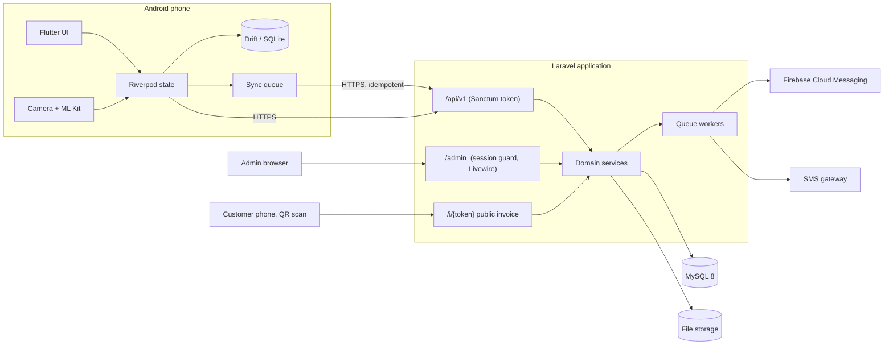

# 01 — System Architecture

Product working name: **Dokani** (দোকানি — "shopkeeper").
Philosophy: *One App. Every Shop. Complete Business Management.*

## 1. Requirement analysis

### 1.1 What is being built

| Surface | Users | Technology |
|---|---|---|
| Shop Owner mobile app | Shop owners, later their staff | Flutter (Android first) |
| REST API | The mobile app | Laravel 13, Sanctum, MySQL 8 |
| Global Admin panel | Platform operators (you) | Laravel + Livewire 4 + Tailwind, same Laravel app |
| Public invoice page | A shop's customers, no login | Server-rendered Blade page behind a random token |

### 1.2 Requirements that were missing or ambiguous, and the decision taken

Every item below is an assumption. Tell me if any is wrong; each is cheap to change now and expensive later.

| # | Gap | Decision |
|---|---|---|
| 1 | Login identifier | **Phone number** (Bangladesh format, normalised to `01XXXXXXXXX`). Email is optional. |
| 2 | Is one user limited to one shop? | Schema allows many shops per user (`shop_users`), which is what "multiple branches" and "employees" need later. v1 UI creates exactly one shop at registration. |
| 3 | Are platform admins ordinary users? | **No.** Separate `admins` table and session guard. A mobile API token can never become an admin session. |
| 4 | Products without variants | Every product has **at least one variant**. A simple product gets one hidden "default" variant. Price, cost, stock, SKU and barcode always live on the variant, so POS, stock and sale lines have one code path. |
| 5 | Fractional quantities (kg, litre, metre) | Quantity is `DECIMAL(14,3)`. Money is `DECIMAL(14,2)`. |
| 6 | Price negotiation at the counter | The server uses the catalogue price. A different unit price is accepted only from a role holding `pos.price_override` (owner and manager by default) and is written to the audit log. |
| 7 | Sale returns / voids | Needed for correct profit ("account for returns"). v1 supports **voiding a whole sale** (stock restored, ledger reversed, payments marked refunded). Partial returns are a later module; the schema already allows them. |
| 8 | Overselling | Blocked online. A per-shop setting `allow_negative_stock` (off by default) lifts it. Offline sales are handled separately (§6). |
| 9 | What happens when a subscription expires | The shop is **not locked out of its data**. It drops to the Free plan's limits and modules until renewed. Suspension is a separate admin action that does block access. |
| 10 | Subscription payments | No payment gateway is specified. Admin records payments manually (bKash/bank reference). A gateway (SSLCommerz / bKash PGW) can be added behind the same `subscription_payments` table. |
| 11 | OTP / SMS provider | None specified. An `SmsSender` interface with a `log` driver (writes the OTP to the log) ships first. A real BD gateway driver needs credentials from you. |
| 12 | Tax / VAT | Not requested. Not built. "Additional charge" is a free amount on the sale. A per-shop VAT rate can be added without schema surgery. |
| 13 | Customer credit limit | Not requested. `customers.credit_limit` is a nullable column; enforcement is off unless set. |
| 14 | Shop time zone and currency | `Asia/Dhaka`, BDT (৳). Stored per shop so the report "today" boundary is correct. All timestamps are stored in UTC. |
| 15 | Opening balances | A customer can be created with an opening due; it is written as a ledger entry, never as a bare number. |
| 16 | iOS | Not targeted in v1. Nothing in the Flutter code prevents it. |

### 1.3 Things the brief asks for that need something from you

| Feature | What is needed |
|---|---|
| OTP by SMS | An account with a Bangladeshi SMS gateway (API key, sender ID) |
| Push notifications | A Firebase project (`google-services.json`, server key) |
| Play Store release | A signing keystore and a Play Console account |
| WhatsApp sharing | Nothing; it uses the Android share sheet / `wa.me` link |
| Thermal printing | A real 58mm and 80mm Bluetooth printer to test against |
| Barcode scanning | Real low-end Android phones to test against. It cannot be verified from a server |

## 2. High-level architecture



One Laravel application serves the API, the admin panel and the public invoice page.
It is a modular monolith: one deployable, one database, domain code grouped by module.
Splitting it into services would add operational cost with no benefit at this size.

### 2.1 Backend layering

```
HTTP request
  → Middleware      auth, tenant resolution, shop status, module/subscription gate, rate limit
  → FormRequest     shape + type validation, tenant-scoped "exists" checks
  → Controller      thin: calls one action, returns one resource
  → Action/Service  business rules, DB transaction, locking
  → Model           Eloquent, tenant global scope
  → API Resource    response shape
```

Rules:

- Controllers contain no business logic.
- Anything that moves money or stock runs inside **one** database transaction in **one** service class.
- Money arithmetic never uses PHP floats. Amounts are parsed into `Brick\Math\BigDecimal` (already a Laravel dependency) and stored as `DECIMAL`.

## 3. Multi-tenancy and tenant isolation

**Model:** single database, shared schema, a `shop_id` column on every shop-owned table.
This is the right trade-off for thousands of small shops: one migration run, cheap hosting, simple backups, cross-shop admin analytics.
A database per tenant would make all of those harder and buys isolation that is achievable in code.

Isolation is enforced in four independent layers, all on the server:

1. **Tenant resolution (middleware `ResolveShop`).**
   The shop is derived from the authenticated user's `shop_users` membership.
   The optional `X-Shop-Id` header only *selects among shops the user already belongs to*; a header naming any other shop returns `403`.
   A `shop_id` in a request body or query string is ignored.

2. **Automatic scoping (trait `BelongsToShop`).**
   Every tenant model has a global scope `WHERE shop_id = <current shop>` and sets `shop_id` on create.
   The scope is **fail-closed**: querying a tenant model with no shop in context throws, instead of returning every shop's rows.
   The only way around it is an explicit `forShop($shop)` / `withoutTenancy()` call, which is used only in admin code, jobs and tests.

3. **Scoped validation.**
   Any ID arriving from the client (`customer_id`, `variant_id`, `vendor_id`, `category_id`) is checked with a rule that looks it up *inside the current shop*.
   A valid ID belonging to another shop is indistinguishable from a non-existent one (`422`/`404`), so IDs cannot be probed.

4. **Database constraints.**
   Uniqueness is always per shop: `UNIQUE(shop_id, phone)`, `UNIQUE(shop_id, code)`, `UNIQUE(shop_id, invoice_no)`, `UNIQUE(shop_id, client_uuid)`.
   Every tenant table has `shop_id` as the leading column of its main indexes.

A dedicated test suite (`TenantIsolationTest`) creates two shops and asserts that every endpoint returns nothing, `403` or `404` for the other shop's records. A new endpoint is not done until it has a case there.

## 4. Authentication and authorisation

| Actor | Mechanism | Notes |
|---|---|---|
| Shop user (mobile) | Sanctum personal access token, sent as `Authorization: Bearer` | Token stored in Android Keystore via `flutter_secure_storage`. One token per device, named after the device, revocable. |
| Platform admin (web) | Session cookie, `admin` guard, CSRF | Separate `admins` table. |
| Customer viewing an invoice | 256-bit random token in the URL | Read-only, rate-limited, no IDs exposed. |

- Passwords: bcrypt via Laravel's `Hash` (cost 12).
- Login, registration and OTP endpoints are rate-limited per phone **and** per IP.
- OTP codes are stored hashed, expire after 5 minutes, and allow 5 attempts.
- Login errors do not reveal whether a phone number is registered.

**Roles inside a shop** (`shop_users.role`): `owner`, `manager`, `cashier`.
Permissions are a server-side map from role to permission strings (`products.manage`, `pos.sell`, `pos.price_override`, `reports.view`, `settings.manage`, …).
v1 only creates owners; the employee module adds the UI to invite managers and cashiers.

**Module and subscription gating** runs as middleware on every route group:

```
auth:sanctum → ResolveShop → EnsureShopIsActive → RequireModule:pos → controller
```

`RequireModule` answers from the shop's plan plus any per-shop override set by the admin.
Limits (products, staff) are checked in the service that creates the record, inside the transaction.
The app receives the resolved entitlements from `GET /me` so it can hide what is unavailable, but hiding is cosmetic; the server refuses regardless.

## 5. Critical transaction design

### 5.1 Creating a sale

One service, `CreateSale`, one transaction:

1. **Idempotency.** Look up `(shop_id, client_uuid)`. If the sale exists, return it with `200` and do nothing else. A unique index backs this up against races.
2. **Lock** the `product_variants` rows involved with `SELECT … FOR UPDATE`, **ordered by id** (consistent order prevents deadlocks).
3. **Price and cost.** Read price and current purchase cost from the locked rows. Apply a client price only with `pos.price_override`.
4. **Stock check.** Reject if any line exceeds stock, unless the shop allows negative stock.
5. **Totals**, computed by the server:
   `subtotal = Σ round(unit_price × qty, 2) − Σ line_discount`
   `grand_total = subtotal − discount + additional_charge`
6. **Payments.** Cash received may exceed what is owed; the excess is change, and only the applied amount is recorded as payment.
   `paid = Σ applied payments`, `due = grand_total − paid`.
   Reject if `paid > grand_total`, or if the client's declared `due`/`grand_total` disagree with the server's.
7. **Due rule.** If `due > 0`: a customer is mandatory. Either `customer_id` (must belong to this shop) or `customer {name, phone}` (find by phone in this shop, otherwise create). Lock the customer row.
   If `due = 0`: no customer is required.
8. **Write** `sales`, `sale_items` (with name, price and **cost snapshot**), `payments`, `stock_movements` (with `balance_after`), decrement variant stock, `customer_ledgers` entries, `invoices` row with public token.
9. **Invoice number** comes from `shop_sequences` (`SELECT … FOR UPDATE`), so numbers are gap-free per shop and never collide.
10. Commit. PDF generation and notifications happen afterwards on the queue.

If any step fails the whole sale rolls back: there is never a sale without its stock movement, or a due without its ledger entry.

### 5.2 Customer ledger

`customer_ledgers` is append-only. Each row has `debit` (customer owes more), `credit` (customer owes less) and `balance_after`.
`customers.current_due` is a cached copy of the latest balance, updated in the same transaction under a row lock.
A scheduled job re-derives balances from the ledger and reports any drift.

### 5.3 Profit

`sale_items.unit_cost` is copied from the variant at the moment of sale and never changes.

```
revenue (net sales) = Σ line totals − sale discount        (additional charges reported separately)
cost of goods       = Σ unit_cost × qty
gross profit        = revenue − cost of goods
```

Voided sales are excluded from both revenue and cost.
Additional charges (delivery, packaging) are shown as their own line, not folded into product profit; whether to count them as income is a shop-level setting, default **yes**.

## 6. Offline mode and synchronisation

The phone is a full POS without a connection; the server is the source of truth once it hears about a sale.

| Data | Direction | Mechanism |
|---|---|---|
| Products, variants, barcodes, categories, customers | Server → device | Delta pull: `GET /sync/pull?since=<cursor>` returns rows changed since the cursor, including soft-deleted ones |
| Sales, due collections, new customers | Device → server | Outbox table in SQLite, pushed in order with `POST /sync/push` |

Rules:

- Every offline record carries a **client-generated UUID v4**. The server enforces `UNIQUE(shop_id, client_uuid)`, so a retry after a dropped connection returns the original result instead of creating a duplicate.
- Each outbox row has a status: `pending → syncing → synced`, or `failed` with the server's reason. Failed rows stay on the device and are shown to the user. **Nothing is deleted from the outbox until the server confirms it.**
- Retries use exponential backoff and run on connectivity change, on app resume and from a manual "Sync now" button.
- **Inventory conflicts.** An offline sale already happened; the goods have left the shop. The server therefore **accepts** it even if stock is insufficient, lets that variant's stock go negative, marks the sale `has_stock_conflict`, and raises a notification so the owner can correct stock. It is never rejected for stock.
- **Price changes.** The price the customer actually paid (captured on the device) is kept. The cost snapshot uses the server's cost at sync time.
- **Invoice numbers.** The device prints a provisional number (`OFF-<device>-<n>`). The server assigns the real sequential number on sync and both are stored.
- **Offline due sales** carry the customer's phone and name (or an offline-created customer's UUID), so the ledger is rebuilt exactly on sync.
- The UI shows a badge on every sale: *Pending sync* or *Confirmed*.

## 7. Global admin panel architecture

Lives in the same Laravel app under `/admin`, guarded by the `admin` session guard.

```
routes/admin.php
app/Livewire/Admin/
    Auth/Login
    Dashboard                 KPI cards, registrations chart, expiring subscriptions, recent activity
    Shops/Index, Shops/Show   search, filter, activate, suspend, change plan, module overrides, activity
    Plans/Index, Plans/Form   prices, limits, modules
    Subscriptions/Index       renew, upgrade, downgrade, record payment
    Catalog/…                 global categories, brands, products, variants, images
    Admins/…                  admin accounts (super admin only)
    AuditLog/Index
resources/views/components/admin/   layout, sidebar, stat card, table, modal, badge
```

Why Livewire and not a Vue SPA: the admin panel is forms and tables used by a handful of people.
Livewire gives reactive UI with no second build pipeline, no second API surface to secure, and direct access to the same services the API uses.

Admin code reads across shops deliberately, through explicit `withoutTenancy()` calls. Every admin write is recorded in `audit_logs`.

## 8. Cross-cutting concerns

- **API conventions.** JSON, versioned at `/api/v1`. Success: `{ "data": … , "meta": … }`. Error: `{ "message": "…", "code": "DUE_REQUIRES_CUSTOMER", "errors": { field: [..] } }`. Machine-readable `code` values let the app show Bangla messages.
- **Localisation.** The app holds its own Bangla and English strings. The API returns error codes plus an English message; `Accept-Language: bn` switches validation messages to Bangla.
- **Files.** Images go to a private Laravel disk (local in development, S3-compatible in production), validated by MIME type, extension and size, re-encoded and resized server-side, served through signed or public CDN URLs.
- **Audit.** `audit_logs` records who did what to which record, with before/after values, for every financial or administrative change.
- **Queues.** Database queue driver to start (no Redis required); jobs for PDF rendering, SMS, push, exports.
- **Backups.** Nightly `mysqldump` + file storage sync to off-site object storage, 30-day retention, monthly restore drill. Details in the deployment guide (Phase 7).

## 9. Major technical risks and mitigations

| # | Risk | Impact | Mitigation |
|---|---|---|---|
| 1 | **Tenant data leak** through a forgotten `where shop_id` | Fatal for a SaaS | Fail-closed global scope, scoped validation rules, per-shop unique keys, mandatory isolation test per endpoint |
| 2 | **Overselling under concurrency** (two cashiers, last item) | Wrong stock | `SELECT … FOR UPDATE` on variants in id order inside the sale transaction; a concurrency test against real MySQL |
| 3 | **Duplicate sales from offline retries** | Double revenue, double stock deduction | Client UUID + unique index + idempotent endpoint returning the original sale |
| 4 | **Lost offline sales** | Lost money, lost trust | Outbox is never pruned before server confirmation; failed rows are visible; SQLite file is included in Android auto-backup |
| 5 | **Offline stock divergence** | Negative stock | Accept, flag, notify; never reject a completed sale |
| 6 | **Floating-point money errors** | Totals off by paisa | `DECIMAL` in MySQL, `BigDecimal` in PHP, integer paisa in Dart; identical rounding rule (half-up, per line) on both sides |
| 7 | **Ledger drift** (cached due ≠ ledger sum) | Wrong customer balance | Balance changed only inside the ledger service under a row lock; nightly reconciliation job |
| 8 | **Scanner performance on low-end phones** | Core feature feels broken | `mobile_scanner` (CameraX + ML Kit), restrict formats to retail codes + QR, 640×480 analysis, in-memory debounce, no overlay animation; must be tested on real devices — I cannot verify this from a server |
| 9 | **Bangla text in PDFs** | Broken conjuncts (যুক্তাক্ষর) | Use **mPDF** (has Bengali OpenType shaping) instead of dompdf; bundle a Bengali font |
| 10 | **Bangla on thermal printers** | ESC/POS code pages have no Bengali | Render the receipt to a bitmap in Flutter and print it as a raster image; English-only fast text mode as an option |
| 11 | **Unverified mobile-money payments** | Owner assumes bKash was received | Payments are recorded as `unverified` manual entries; the UI never says "verified" without a gateway callback |
| 12 | **Large catalogues on cheap phones** | Slow POS | Paginated delta sync, indexed SQLite lookups for barcodes, lazy grids, thumbnails ≤ 200px cached on disk |
| 13 | **Subscription rules bypassed by a modified app** | Revenue loss | All limits and modules enforced in middleware and services; the app only mirrors them |
| 14 | **Public invoice enumeration** | Customer data leak | 256-bit random token, no sequential IDs, rate limit, `noindex`, customer phone masked on the public page |
| 15 | **Clock skew on phones** | Wrong sale time | Store both the device's `sold_at` and the server's `received_at`; reports use `sold_at` clamped to a sane window |
