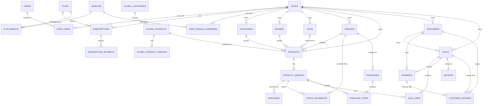

# 02 — Database Design

Engine: MySQL 8 (InnoDB, `utf8mb4_unicode_ci`). MariaDB 10.6+ also works.

## Conventions

| Topic | Rule |
|---|---|
| Primary keys | `BIGINT UNSIGNED AUTO_INCREMENT`. Never used as a public credential. |
| Tenant column | `shop_id BIGINT UNSIGNED NOT NULL`, FK to `shops.id`, first column of the table's main indexes |
| Money | `DECIMAL(14,2)`. Never `FLOAT`/`DOUBLE`. |
| Quantity | `DECIMAL(14,3)` (supports 0.250 kg) |
| Timestamps | `created_at`, `updated_at` in UTC on every table |
| Soft deletes | `deleted_at` on master data that sales refer to (products, variants, customers, vendors, categories, brands, shops, users) |
| Append-only | `payments`, `customer_ledgers`, `stock_movements`, `audit_logs` are never updated or deleted by application code; corrections are new rows |
| Offline identity | `client_uuid CHAR(36)` with `UNIQUE(shop_id, client_uuid)` on anything a phone can create offline |
| Enums | Stored as `VARCHAR` and validated by PHP enums, so adding a value needs no `ALTER TABLE` |

Legend: **T** = tenant-owned (has `shop_id`), **G** = global/platform.

## Entity relationship diagram

## Table design

### Platform and identity

#### `users` (G) — people who log in to the mobile app
| Column | Type | Notes |
|---|---|---|
| id | bigint PK | |
| name | varchar(120) | |
| phone | varchar(15) | **unique**, normalised `01XXXXXXXXX` |
| email | varchar(190) null | unique when present |
| password | varchar(255) | bcrypt |
| phone_verified_at | timestamp null | |
| locale | varchar(5) default `bn` | |
| is_active | boolean default 1 | |
| last_login_at | timestamp null | |
| timestamps, deleted_at | | |

#### `admins` (G) — platform operators, separate guard
`id`, `name`, `email` unique, `password`, `role` (`super_admin`, `support`), `is_active`, `last_login_at`, `remember_token`, timestamps.

#### `shops` (G root of each tenant)
| Column | Type | Notes |
|---|---|---|
| id | bigint PK | |
| owner_id | FK users | |
| name | varchar(150) | |
| shop_type | varchar(40) | `grocery`, `super_shop`, `clothing`, `cosmetics`, `electronics`, `pharmacy`, `stationery`, `hardware`, `fruit_vegetable`, `mobile_accessories`, `general` |
| phone | varchar(15) | shown on invoices |
| address | varchar(255) null | |
| logo_path | varchar(255) null | |
| status | varchar(20) | `active`, `inactive`, `suspended` |
| suspended_reason | varchar(255) null | |
| currency | char(3) default `BDT` | |
| timezone | varchar(40) default `Asia/Dhaka` | |
| settings | json null | `allow_negative_stock`, `low_stock_threshold`, `receipt_width`, `invoice_footer`, `charge_counts_as_income` |
| timestamps, deleted_at | | |

Indexes: `(status)`, `(owner_id)`, `(created_at)`.

#### `shop_users` (G pivot) — membership and role
`id`, `shop_id` FK, `user_id` FK, `role` (`owner`,`manager`,`cashier`), `is_active`, timestamps.
Unique `(shop_id, user_id)`.

#### `personal_access_tokens` (G) — Sanctum, standard table
One row per device login.

#### `otp_codes` (G)
`id`, `phone`, `purpose` (`register`,`reset_password`), `code_hash`, `attempts` tinyint, `expires_at`, `consumed_at` null, timestamps. Index `(phone, purpose)`.

#### `devices` (T) — phones that have synced
`id`, `shop_id`, `user_id`, `device_uuid` char(36), `name` null, `platform` null, `app_version` null, `last_seen_at`, `last_synced_at`, timestamps. Unique `(shop_id, device_uuid)`.
`sales.device_id` (nullable) records which phone an offline sale came from. An `fcm_token` column will be added with push notifications (Phase 7).

### Plans, modules, subscriptions

#### `plans` (G)
| Column | Type | Notes |
|---|---|---|
| id | bigint PK | |
| code | varchar(40) unique | `free`, `basic`, `standard`, `premium` |
| name | varchar(80) | |
| description | varchar(255) null | |
| price_monthly | decimal(12,2) | |
| price_yearly | decimal(12,2) | |
| max_products | int unsigned null | null = unlimited |
| max_users | int unsigned null | employee limit |
| max_monthly_sales | int unsigned null | |
| features | json null | future flags |
| is_active | boolean | |
| is_default | boolean | the plan new shops and expired shops fall back to |
| sort_order | smallint | |
| timestamps | | |

#### `modules` (G)
`id`, `key` unique, `name`, `description`, `is_core` (core modules are in every plan and cannot be disabled), `is_available` (false for modules that are planned but not built; never granted), `sort_order`, timestamps.
Core: `products`, `pos`, `customers`, `offline`. Optional: `inventory`, `vendors`, `reports`, `exports`, `global_catalog`. Planned: `expenses`, `purchases`, `employees`, `branches`, `loyalty`, `analytics`.

#### `plan_module` (G pivot)
`plan_id`, `module_id`. Primary key `(plan_id, module_id)`.

#### `shop_module_overrides` (G) — admin enables/disables a module for one shop
`id`, `shop_id`, `module_id`, `is_enabled`, `admin_id` null, timestamps. Unique `(shop_id, module_id)`.

Effective module set for a shop = plan modules ± overrides.

#### `subscriptions` (G, per shop)
| Column | Type | Notes |
|---|---|---|
| id | bigint PK | |
| shop_id | FK | |
| plan_id | FK | |
| billing_cycle | varchar(10) | `monthly`, `yearly`, `lifetime` (free) |
| status | varchar(20) | `active`, `expired`, `cancelled` |
| price | decimal(12,2) | price agreed at the time |
| starts_at | timestamp | |
| ends_at | timestamp null | null for the free plan |
| cancelled_at | timestamp null | |
| timestamps | | |

Index `(shop_id, status)`, `(ends_at)`. One `active` row per shop at a time (enforced in the service; history rows are kept).

#### `subscription_payments` (G)
`id`, `subscription_id`, `shop_id`, `amount` decimal(12,2), `method`, `reference` null, `paid_at`, `recorded_by` (admin) null, `note` null, timestamps. Feeds MRR and revenue statistics.

### Global catalogue (managed by admin)

- `global_categories` — `id`, `name`, `name_bn` null, `sort_order`, timestamps.
- `global_products` — `id`, `global_category_id` null, `name`, `name_bn` null, `brand` varchar(100) null (plain text; becomes a shop brand on import), `description` null, `default_unit` (name of a built-in unit), `image_path` null, `barcode` varchar(64) null (index), `is_active`, timestamps, deleted_at.
- `global_product_variants` — `id`, `global_product_id`, `name`, `options` json null, `barcode` null, `sort_order`, timestamps.

Global rows hold **no prices and no stock**. Importing copies them into the shop's `products`/`product_variants` and stores `products.global_product_id` as a reference only. Later edits by the shop never touch the global row, and vice versa.

### Shop catalogue

#### `categories` (T)
`id`, `shop_id`, `parent_id` null, `name`, `sort_order`, timestamps, deleted_at. Index `(shop_id, parent_id, name)`.
Names are unique per shop and parent among non-deleted rows; this is enforced in validation, not by a unique index, so a deleted category's name can be reused.

#### `brands` (T)
`id`, `shop_id`, `name`, timestamps, deleted_at. Unique `(shop_id, name)`.

#### `units` (T + system)
`id`, `shop_id` **null for built-in units**, `name`, `name_bn` null, `short_name`, `allows_decimal` boolean, timestamps.
A shop sees the built-in rows plus its own (`ShopOrSystemScope`); only its own can be changed.
Built-ins: Piece, Kilogram, Gram, Liter, Milliliter, Packet, Box, Dozen, Meter, Feet, Bottle, Pair, Carton. Shops add custom rows with their own `shop_id`.

#### `vendors` (T)
`id`, `shop_id`, `name`, `phone` null, `company_name` null, `address` null, `notes` null, timestamps, deleted_at. Index `(shop_id, name)`, `(shop_id, phone)`.

#### `products` (T)
| Column | Type | Notes |
|---|---|---|
| id | bigint PK | |
| shop_id | FK | |
| global_product_id | FK null | set when imported |
| category_id | FK null | |
| brand_id | FK null | |
| unit_id | FK | |
| vendor_id | FK null | the vendor this product is bought from; one vendor supplies many products |
| name | varchar(190) | |
| description | text null | |
| image_path | varchar(255) null | |
| storage_location | varchar(100) null | shelf / rack |
| has_variants | boolean | false = one hidden default variant |
| low_stock_threshold | decimal(14,3) null | overrides the shop default |
| is_active | boolean | |
| timestamps, deleted_at | | |

Indexes: `(shop_id, name)`, `(shop_id, category_id)`, `(shop_id, brand_id)`, `(shop_id, updated_at)` for delta sync; `FULLTEXT(name)`.

#### `product_variants` (T) — the sellable, stock-holding unit
| Column | Type | Notes |
|---|---|---|
| id | bigint PK | |
| shop_id | FK | |
| product_id | FK | |
| name | varchar(120) null | `M`, `500ml`, `128GB`; null for the default variant |
| options | json null | `{"size":"M","color":"Red"}`. Exposed by the API as `attributes`; the column is named `options` because Eloquent reserves `attributes` |
| sku | varchar(64) null | indexed `(shop_id, sku)`; not unique |
| purchase_price | decimal(14,2) | current cost |
| selling_price | decimal(14,2) | |
| stock_quantity | decimal(14,3) | cached balance; changed only by the stock service |
| is_default | boolean | |
| is_active | boolean | |
| timestamps, deleted_at | | |

Indexes: `(shop_id, product_id)`, `(shop_id, stock_quantity)`, `(shop_id, updated_at)`.

#### `barcodes` (T)
`id`, `shop_id`, `product_variant_id`, `code` varchar(64), timestamps. Rows are hard-deleted with their variant, so a code can be reused.
**Unique `(shop_id, code)`** — one code resolves to exactly one variant in a shop; a variant may have several codes.

#### `stock_movements` (T, append-only)
| Column | Type | Notes |
|---|---|---|
| id | bigint PK | |
| shop_id | FK | |
| product_variant_id | FK | |
| type | varchar(20) | `opening`, `stock_in`, `stock_out`, `sale`, `sale_void`, `adjustment`, `purchase` |
| quantity | decimal(14,3) | signed: negative for outflow |
| balance_after | decimal(14,3) | |
| unit_cost | decimal(14,2) null | |
| vendor_id | FK null | set on stock-in; gives a vendor's purchase history |
| reference_type / reference_id | morph null | sale, purchase, … |
| note | varchar(255) null | |
| created_by | FK users null | |
| created_at | timestamp | |

Index `(shop_id, product_variant_id, id)`, `(reference_type, reference_id)`.

### Customers and dues

#### `customers` (T)
| Column | Type | Notes |
|---|---|---|
| id | bigint PK | |
| shop_id | FK | |
| client_uuid | char(36) null | set when created offline |
| name | varchar(120) | |
| phone | varchar(15) | **unique `(shop_id, phone)`** |
| address | varchar(255) null | |
| notes | text null | |
| credit_limit | decimal(14,2) null | |
| current_due | decimal(14,2) default 0 | cached ledger balance |
| total_purchases | decimal(14,2) default 0 | cached |
| total_paid | decimal(14,2) default 0 | cached |
| last_purchase_at | timestamp null | |
| timestamps, deleted_at | | |

The same phone number in two shops is two unrelated rows.

#### `customer_ledgers` (T, append-only)
| Column | Type | Notes |
|---|---|---|
| id | bigint PK | |
| shop_id | FK | |
| customer_id | FK | |
| type | varchar(20) | `opening`, `sale_due`, `payment`, `sale_void`, `adjustment` |
| debit | decimal(14,2) | increases what the customer owes |
| credit | decimal(14,2) | decreases it |
| balance_after | decimal(14,2) | |
| sale_id | FK null | |
| payment_id | FK null | |
| note | varchar(255) null | |
| created_by | FK users null | |
| created_at | timestamp | |

Index `(shop_id, customer_id, id)`.

### Sales

#### `sales` (T)
| Column | Type | Notes |
|---|---|---|
| id | bigint PK | |
| shop_id | FK | |
| client_uuid | char(36) | **unique `(shop_id, client_uuid)`** — idempotency key |
| invoice_no | varchar(30) | unique `(shop_id, invoice_no)` |
| offline_ref | varchar(40) null | provisional number printed offline |
| customer_id | FK null | required when `due_amount > 0` |
| subtotal | decimal(14,2) | Σ line totals |
| discount_amount | decimal(14,2) | sale-level discount |
| additional_charge | decimal(14,2) | |
| grand_total | decimal(14,2) | |
| paid_amount | decimal(14,2) | at time of sale |
| due_amount | decimal(14,2) | at time of sale (history; live balance is the ledger) |
| change_amount | decimal(14,2) | cash returned |
| total_cost | decimal(14,2) | Σ unit_cost × qty |
| total_items | decimal(14,3) | units sold |
| status | varchar(20) | `completed`, `voided` |
| source | varchar(10) | `online`, `offline` |
| has_stock_conflict | boolean | offline sale exceeded stock |
| note | varchar(255) null | |
| sold_at | timestamp | when it happened (device clock for offline) |
| received_at | timestamp | when the server stored it |
| voided_at, voided_by, void_reason | null | |
| created_by | FK users | |
| timestamps | | |

CHECK constraint `sales_totals_check`: `grand_total = subtotal - discount_amount + additional_charge`, `grand_total = paid_amount + due_amount`, all amounts `>= 0`. Also `payments.amount > 0` and non-negative ledger amounts.
Indexes: `(shop_id, sold_at)`, `(shop_id, customer_id)`, `(shop_id, status, sold_at)`.

#### `sale_items` (T)
| Column | Type | Notes |
|---|---|---|
| id | bigint PK | |
| shop_id | FK | |
| sale_id | FK | |
| product_id | FK | |
| product_variant_id | FK | |
| product_name | varchar(190) | snapshot |
| variant_name | varchar(120) null | snapshot |
| unit_name | varchar(20) | snapshot |
| quantity | decimal(14,3) | |
| unit_price | decimal(14,2) | snapshot |
| unit_cost | decimal(14,2) | **snapshot — keeps historical profit stable** |
| discount_amount | decimal(14,2) | line discount |
| line_total | decimal(14,2) | `round(unit_price × quantity, 2) − discount_amount` |
| timestamps | | |

Index `(shop_id, sale_id)`, `(shop_id, product_variant_id, created_at)` for best-seller reports.

#### `payments` (T, append-only)
| Column | Type | Notes |
|---|---|---|
| id | bigint PK | |
| shop_id | FK | |
| client_uuid | char(36) null | unique `(shop_id, client_uuid)`; idempotent due collections |
| sale_id | FK null | set for payment at checkout |
| customer_id | FK null | set for due collection |
| type | varchar(20) | `sale`, `due_collection`, `refund` |
| method | varchar(20) | `cash`, `bkash`, `nagad`, `bank`, `card`, `other` |
| amount | decimal(14,2) | amount applied (never includes change) |
| received_amount | decimal(14,2) null | cash handed over |
| transaction_id | varchar(100) null | |
| reference | varchar(190) null | |
| verification | varchar(20) default `unverified` | becomes `gateway_verified` **only** via a gateway callback |
| paid_at | timestamp | |
| created_by | FK users | |
| timestamps | | |

"Due" is not a payment row. It is `sales.due_amount` plus a ledger debit.
Index `(shop_id, paid_at)`, `(shop_id, method, paid_at)`, `(shop_id, customer_id)`.

#### `invoices` (T)
`id`, `shop_id`, `sale_id` **unique**, `invoice_no`, `public_token` char(43) **unique** (32 random bytes, base64url), `shop_snapshot` json (name, address, phone, logo and footer at time of sale), `issued_at`, timestamps.
The public route looks up by `public_token` only. PDFs are rendered on request, not stored.

#### `shop_sequences` (T)
`shop_id`, `key` (`invoice`), `next_value` bigint. Primary key `(shop_id, key)`. Read and advanced inside the sale transaction while the shop's row in `shops` is locked (see `ShopLock`), so numbers are gap-free and never repeat.

### Purchases and expenses (schema now, UI in later phases)

- `purchases` (T) — `id`, `shop_id`, `vendor_id` null, `reference_no` null, `total_amount`, `paid_amount`, `due_amount`, `purchased_at`, `note`, `created_by`, timestamps. Gives vendor purchase history and, later, supplier due.
- `purchase_items` (T) — `id`, `shop_id`, `purchase_id`, `product_variant_id`, `quantity`, `unit_cost`, `line_total`. Creating one writes a `stock_movements` row of type `purchase`.
- `expense_categories` (T) — `id`, `shop_id`, `name`.
- `expenses` (T) — `id`, `shop_id`, `expense_category_id` null, `amount`, `method`, `note`, `spent_at`, `created_by`, timestamps.

### Operations

#### `audit_logs` (G, append-only)
`id`, `shop_id` null (null for platform events), `actor_type` (`user`,`admin`,`system`), `actor_id` null, `action` (`sale.voided`, `shop.suspended`, `product.price_changed`, …), `subject_type`, `subject_id`, `old_values` json null, `new_values` json null, `ip` null, `user_agent` null, `created_at`.
Index `(shop_id, created_at)`, `(subject_type, subject_id)`, `(action)`.

#### `shop_notifications` (T)
`id`, `shop_id`, `type`, `title`, `body` null, `data` json null, `read_at` null, timestamps. Index `(shop_id, read_at, id)`.
The only type raised so far is `stock_conflict` (an offline sale took stock below zero); `data` holds `sale_id`, `invoice_no` and the product names. `low_stock` and `subscription_expiring` are planned.

#### Laravel infrastructure tables
`jobs`, `failed_jobs`, `job_batches`, `cache`, `cache_locks`, `sessions` (admin panel), `password_reset_tokens` (admins).

## Integrity rules enforced in the database

- Foreign keys on every relation. `RESTRICT` on anything a sale refers to (a product with sales can only be soft-deleted).
- `CHECK` constraints on sales totals and on non-negative money columns.
- Unique keys listed above; all tenant uniques start with `shop_id`.
- No `ON DELETE CASCADE` from `shops` to financial tables: a shop is soft-deleted, never hard-deleted by the application.

## Table creation order (migrations)

1. Phase 1 — `users`, `admins`, `personal_access_tokens`, `shops`, `shop_users`, `otp_codes`, `modules`, `plans`, `plan_module`, `shop_module_overrides`, `subscriptions`, `subscription_payments`, `audit_logs`, infrastructure tables
2. Phase 2 — `units`, `brands`, `vendors`, `global_categories`, `global_products`, `global_product_variants`, `products`, `product_variants`, `barcodes`, `stock_movements` (`categories` was created in Phase 1)
3. Phase 3 — `customers`, `shop_sequences`, `sales`, `sale_items`, `payments`, `customer_ledgers`, `invoices`
4. Phase 5 — `devices`, `shop_notifications`, `sales.device_id`, index `customers (shop_id, updated_at)`
5. Later — `purchases`, `purchase_items`, `expense_categories`, `expenses`

## The phone's own database (Phase 5)

Offline mode keeps a small SQLite database on the phone, one file per shop (`dokani_shop_<id>.sqlite`), managed with Drift. It is a working copy and a queue, not a second source of truth.

| Table | Holds |
|---|---|
| `cached_products` | `id`, lower-cased name for searching, and the product exactly as the server sent it (JSON, with variants and barcodes) |
| `cached_barcodes` | `code` → `variant_id`, `product_id`; rebuilt whenever a product is stored |
| `cached_customers` | `id`, `phone`, lower-cased name, and the customer as the server sent it |
| `outbox_entries` | one row per sale or due collection made on the phone: `client_uuid` (unique), `kind`, the request `payload`, a `display` copy for showing it before the server has seen it, `status` (`pending`, `synced`, `failed`), `error_code`, `error_message`, `attempts`, `created_at`, and the `server` answer once confirmed |
| `sync_state` | key/value: the pull cursor for each list |

Rules the code keeps: a row leaves `outbox_entries` only when it is `synced` and more than seven days old, or when the user deletes a `failed` row on purpose; `pending` rows are never deleted.
